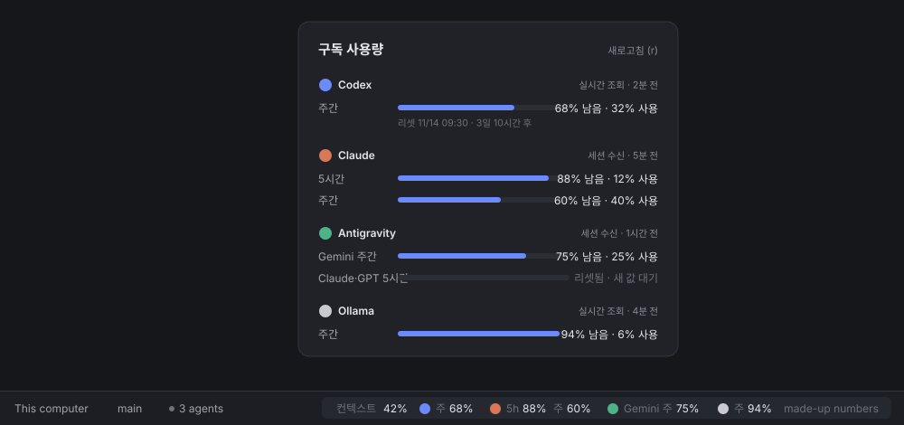

# herdr-usage

Subscription usage for Codex, Claude Code, Antigravity (agy) and Ollama Cloud in the [Herdr](https://herdr.dev) app's status bar, with a detail popup.

**[English](#english)** · **[한국어](#한국어)**



*The preview uses made-up numbers.*

---

## English

The status bar keeps everything Herdr's own `workspace-status` shows (machine, branch, agents count, "needs you", the palette hint) and adds how much of each usage window is left, on the right. Click it, or run `herdr-app do gun-usage-bar.open`, for a popup with every window: remaining and used percent, the reset time, when the value was observed, and a manual refresh (`r`). The interface text is in Korean.

With the usage bar open, quota refreshes automatically every 5 minutes, including Antigravity on macOS, Linux and Windows; no conversation is needed.

There is no daemon, no launchd job, no model call and no new API key. It needs no npm packages.

### Requirements

- macOS, Linux or Windows. Tested on macOS with Herdr 0.1.15 and on Windows; Linux runs the automated tests. Windows support was added in 0.1.1.
- The Herdr app, opened at least once (`herdr-app` on `PATH`, in `~/.local/bin`, or set `HERDR_APP_BIN`).
- Node.js 22 or newer (tested with 24).
- Any of the CLIs whose usage you want: Codex CLI, Claude Code, Antigravity, Ollama. Missing ones are shown as waiting or not connected.

### Install

The plugin carries a skill, `herdr-usage`, for Claude Code and Codex. Installing the plugin installs nothing in Herdr; ask the agent to "install herdr-usage" and it runs the bundled installer after telling you what changes.

```bash
claude plugin marketplace add gunkr-com/gun-marketplace
claude plugin install herdr-usage@gun-marketplace
```

```bash
codex plugin marketplace add gunkr-com/gun-marketplace
codex plugin add herdr-usage@gun-marketplace
```

Or run the installer yourself from a checkout or the installed plugin folder:

```bash
node install.mjs                 # collector, both mods, statusLine wrappers, gun-usage layout (shown)
node install.mjs --no-activate   # the same, without switching layouts (no running window needed)
node status.mjs                  # what is installed, and each source's state (exits 1 if not installed)
```

If no Herdr window is running, use `--no-activate`. The first snapshot is collected when Herdr draws the bar, so `status.mjs` says `snapshot: never` until the layout is shown.

Other options: `--skip-layout`, `--skip-settings`, `--skip-claude`, `--skip-agy`.

The installer checks everything before its first write: platform, Node.js, the Herdr home, `herdr-app`, name collisions, each settings file, Herdr's main layout, a running window (unless `--no-activate`), and `herdr-app check` on both mods with their paths filled in. If a check fails it exits nonzero, says what to fix, and changes nothing. A mod, layout or `usage` folder of the same name that herdr-usage did not create is never overwritten.

Environment it follows:

| Variable | Use |
| :- | :- |
| `HERDR_APP_HOME` | Herdr's home (default `~/.config/herdr-app`) |
| `HERDR_APP_BIN` | Path to `herdr-app` |
| `HERDR_USAGE_NODE` | The Node.js the statusline and Herdr run. Default: a `node` on `PATH` (or `/opt/homebrew/bin`, `/usr/local/bin`, `/usr/bin`) that resolves to the Node.js running the installer, so a Homebrew upgrade does not break it; otherwise that Node.js itself |
| `CLAUDE_CONFIG_DIR` | Claude Code's config folder (default `~/.claude`) |
| `CODEX_HOME` | Codex's home, for its session files |
| `HERDR_USAGE_HOME` | Where the collector lives (default `<Herdr home>/usage`) |

On Windows, the installer finds native `.exe` programs, including the standard native and npm Codex installations. For a custom Codex location, set `HERDR_USAGE_CODEX` to its absolute `codex.exe` path; `.cmd` and `.ps1` launchers are not supported. Windows uses a Node.js statusline wrapper and terminates only the temporary app-server process tree. See [Windows setup](WINDOWS.md).

The settings files, `node`, `codex` and `CODEX_HOME` found at install time are recorded in `<Herdr home>/usage/install.json`, because Herdr runs the collector without your shell environment.

### Update

Update the plugin, then run the installer again from the new plugin folder (or ask the agent to update herdr-usage):

```bash
claude plugin marketplace update gun-marketplace && claude plugin update herdr-usage@gun-marketplace
codex plugin marketplace upgrade gun-marketplace && codex plugin add herdr-usage@gun-marketplace
```

A re-run updates in place. It keeps the layout you have shown, your edits to the `gun-usage` layout, the saved original statuslines and the captured data, and never wraps a wrapper twice.

### What changes

| Where | What |
| :- | :- |
| `<Herdr home>/usage/{bin,lib,cache,state}` | The collector and statusline wrapper; captured data and state (0700 folders, 0600 files) |
| `<Herdr home>/mods/gun-usage-bar`, `gun-usage-detail` | The status bar and the popup |
| `<Herdr home>/layouts/gun-usage.json` | A copy of Herdr's main layout whose status block is `gun-usage-bar`. Spaces, tabs and panes stay as they are when it is shown. Sizes you dragged in `main` are not copied |
| Claude Code `settings.json` | Only `statusLine`. On macOS/Linux the command becomes `/bin/sh '<usage>/bin/statusline-wrap' claude <base64 of the original>`: your original runs first with the same input, and its output and exit code pass through unchanged |
| `~/.gemini/antigravity-cli/settings.json` | Only `statusLine`, as above. Without an original command it is capture-only, with `stack_with_default: true` so agy's built-in line stays |

On Windows, `statusLine.command` runs the bundled `statusline-wrap.mjs` with Node.js. It passes stdin to the original command, preserves its output and exit code, and then captures the quota fields locally. The collector uses this computer's sessions and credentials even when viewing a remote machine in Herdr.

A CLI whose config folder does not exist is skipped. If the folder exists but `settings.json` does not, the file is created and removed again on uninstall if nothing else was added. A settings file is rewritten only when that keeps its formatting; otherwise the installer stops before changing anything. The original value of each `statusLine` key is kept in `usage/state/<cli>-statusline.orig.json`; the whole settings file is never copied.

### Where the numbers come from

| Source | How | Shown as |
| :- | :- | :- |
| Codex | A short-lived `codex app-server` runs `account/rateLimits/read` (15 s limit; its process group is killed afterwards). If that fails, the newest `rate_limits` event in recent `$CODEX_HOME/sessions` rollouts, with the event's own time | 실시간 조회 / Codex 턴 기록 |
| Claude Code | Existing local OAuth login queries subscription usage directly; statusline captures remain a fallback and provide context | 실시간 조회 / 세션 수신 |
| Antigravity | The CLI's read-only `-p /usage --output-format json` refreshes quota without an agent turn; statusline captures remain a fallback | 실시간 조회 / 세션 수신 |
| Ollama Cloud | `GET ollama.com/api/balance`, signed with the device key `~/.ollama/id_ed25519`, or `OLLAMA_API_KEY` as a Bearer token | 실시간 조회 |
| Ollama local | HTTP only: `127.0.0.1:11434/api/version` and `/api/ps`. The `ollama` CLI is never run | 로컬 실행 중 / 꺼짐 |

Rules it keeps:

- A missing window is unknown, never 0% or 100%. A window whose reset time has passed shows `리셋됨 · 새 값 대기` instead of the old value.
- A statusline re-run that repeats the same values does not make old data look fresh. Sessions on the same account merge so an idle older session cannot pull usage backwards.
- A failed poll keeps the last good values with their original time. Network sources are read at most every 5 minutes; a manual refresh at most once a minute; a 429 `Retry-After` is honored.
- The context row shows only for the focused terminal running Claude Code or agy. Codex context is not shown.
- Captures are whitelisted: no transcript paths, prompt ids, emails, titles, token or cost counts, account ids or auth headers. Only the folder name of the working directory is kept and session ids are hashed.

### Uninstall

```bash
node uninstall.mjs               # or ask the agent to uninstall herdr-usage
node uninstall.mjs --keep-files  # restore the statusLines only
```

Each `statusLine` is restored only while it is still the wrapper; one you changed since is left alone. If `gun-usage` is shown, Herdr switches back to `main` first. Then the layout, both mods and the `usage` folder go. If a statusLine could not be restored, `usage/{bin,lib,state}` stay so it keeps working, and the script exits nonzero. Remove the plugin itself with `claude plugin uninstall herdr-usage@gun-marketplace` or `codex plugin remove herdr-usage@gun-marketplace`.

You can always switch back to Herdr's layout with `ctrl-shift-l` or `herdr-app do layout.switch '{"name":"main"}'`.

### Limits

- Direct subscription queries need a valid local login and the Herdr usage bar open. They run without an agent terminal. Where direct queries are unavailable, session captures retain their original observation time and can become stale.
- The Ollama device-key signature for `/api/balance` is undocumented; the documented way is an API key. If it stops working, set `OLLAMA_API_KEY` in the environment Herdr runs with.
- A project-level `.claude/settings*.json` with its own `statusLine`, or a Claude config folder the installer did not wrap, adds no data.
- If agy prints nothing in `stack_with_default` mode, it may add a blank line under its built-in line.

### Tests

```bash
node --test test/*.test.mjs
```

On macOS/Linux, run the command above. On Windows run `node --test test/parse.test.mjs test/windows.test.mjs`. CI runs synthetic parser and native-wrapper tests on Windows; the additional isolated installer integration test runs when `herdr-app` is installed. Tests use temporary settings, not real credentials or network. The Unix shell-based setup suites remain on macOS/Linux.

### License

[MIT](LICENSE). Not affiliated with Herdr, Anthropic, OpenAI, Google or Ollama.

---

## 한국어

하단 바는 Herdr 기본 `workspace-status`가 보여 주는 것(기기, 브랜치, 에이전트 수, "needs you", 명령 팔레트 안내)을 그대로 두고, 오른쪽에 사용량 창마다 남은 비율을 더합니다. 클릭하거나 `herdr-app do gun-usage-bar.open`을 실행하면 모든 창의 남은·사용 비율, 리셋 시각, 값을 받은 시각과 수동 새로고침(`r`)이 있는 팝업이 열립니다. 화면 문구는 한국어입니다.

데몬, launchd 작업, 모델 호출, 새 API 키가 없습니다. npm 패키지도 필요 없습니다.

### 요구 사항

- macOS, Linux 또는 Windows. macOS의 Herdr 0.1.15와 Windows에서 시험했고, Linux에서는 자동 테스트를 실행합니다. Windows 지원은 0.1.1에서 추가했습니다.
- 한 번 이상 연 Herdr 앱(`herdr-app`이 `PATH`나 `~/.local/bin`에 있거나 `HERDR_APP_BIN`으로 지정)
- Node.js 22 이상(24와 25에서 시험)
- 사용량을 보고 싶은 CLI: Codex CLI, Claude Code, Antigravity, Ollama. 없는 것은 대기나 연결 필요로 표시됩니다.

### 설치

플러그인에는 Claude Code와 Codex에서 쓰는 `herdr-usage` 스킬이 들어 있습니다. 플러그인을 설치해도 Herdr에는 아무것도 설치되지 않습니다. 에이전트에게 "herdr-usage 설치해 줘"라고 하면 바뀌는 것을 알린 뒤 동봉된 설치기를 실행합니다.

```bash
claude plugin marketplace add gunkr-com/gun-marketplace
claude plugin install herdr-usage@gun-marketplace
```

```bash
codex plugin marketplace add gunkr-com/gun-marketplace
codex plugin add herdr-usage@gun-marketplace
```

직접 실행하려면 체크아웃이나 설치된 플러그인 폴더에서:

```bash
node install.mjs                 # 수집기, mod 두 개, statusLine 래퍼, gun-usage 레이아웃(표시)
node install.mjs --no-activate   # 같지만 레이아웃을 바꾸지 않음(창이 떠 있지 않아도 됨)
node status.mjs                  # 설치 상태와 소스별 상태(설치되지 않았으면 1로 종료)
```

Herdr 창이 떠 있지 않으면 `--no-activate`를 씁니다. 첫 수집은 Herdr가 하단 바를 그릴 때 일어나므로, 레이아웃을 표시하기 전에는 `status.mjs`가 `snapshot: never`라고 나옵니다.

다른 옵션: `--skip-layout`, `--skip-settings`, `--skip-claude`, `--skip-agy`

설치기는 처음 쓰기 전에 모두 확인합니다: 플랫폼, Node.js, Herdr 홈, `herdr-app`, 이름 충돌, 각 설정 파일, Herdr main 레이아웃, 실행 중인 창(`--no-activate`가 아니면), 경로를 채운 두 mod의 `herdr-app check`. 하나라도 실패하면 0이 아닌 코드로 끝나고, 고칠 것을 알려 주며, 아무것도 바꾸지 않습니다. herdr-usage가 만들지 않은 같은 이름의 mod, 레이아웃, `usage` 폴더는 덮어쓰지 않습니다.

따르는 환경 변수는 영어 절의 표와 같습니다(`HERDR_APP_HOME`, `HERDR_APP_BIN`, `HERDR_USAGE_NODE`, `CLAUDE_CONFIG_DIR`, `CODEX_HOME`, `HERDR_USAGE_HOME`). `HERDR_USAGE_NODE`가 없으면 설치기를 실행한 Node.js와 같은 실체를 가리키는 `PATH`의 `node`(또는 `/opt/homebrew/bin`, `/usr/local/bin`, `/usr/bin`)를 씁니다. 그래서 Homebrew로 Node.js를 올려도 깨지지 않습니다. Herdr는 셸 환경 없이 수집기를 실행하므로, 설치 때 찾은 설정 파일, `node`, `codex`, `CODEX_HOME`을 `<Herdr 홈>/usage/install.json`에 기록합니다.

### 업데이트

플러그인을 업데이트한 뒤 새 플러그인 폴더에서 설치기를 다시 실행합니다(또는 에이전트에게 herdr-usage 업데이트를 요청).

```bash
claude plugin marketplace update gun-marketplace && claude plugin update herdr-usage@gun-marketplace
codex plugin marketplace upgrade gun-marketplace && codex plugin add herdr-usage@gun-marketplace
```

다시 실행하면 제자리에서 업데이트합니다. 지금 보이는 레이아웃, `gun-usage` 레이아웃을 고친 내용, 저장된 원래 statusLine, 수집한 데이터를 유지하며 래퍼를 두 번 감싸지 않습니다.

Windows 설치기는 기본 native/npm Codex 설치의 `codex.exe`를 찾습니다. 별도 위치라면 `HERDR_USAGE_CODEX`에 절대 경로를 지정하세요(`.cmd`·`.ps1` 런처 제외). Windows는 Node.js 상태줄 래퍼를 쓰고, 임시 app-server 프로세스 트리만 종료합니다. 수집 대상은 이 컴퓨터의 세션과 계정이며 Herdr에서 원격 Mac을 선택해도 바뀌지 않습니다. [Windows 안내](WINDOWS.md)를 참고하세요.

### 바뀌는 것

- `<Herdr 홈>/usage/{bin,lib,cache,state}`: 수집기와 statusLine 래퍼, 수집 데이터와 상태(폴더 0700, 파일 0600)
- `<Herdr 홈>/mods/gun-usage-bar`, `gun-usage-detail`: 하단 바와 팝업
- `<Herdr 홈>/layouts/gun-usage.json`: 상태 블록을 `gun-usage-bar`로 바꾼 Herdr main 레이아웃 복사본. 표시할 때 space, 탭, pane은 그대로입니다. `main`에서 끌어 바꾼 크기는 복사되지 않습니다.
- Claude Code `settings.json`, `~/.gemini/antigravity-cli/settings.json`: `statusLine` 키만. 원래 명령이 같은 입력으로 먼저 실행되고 출력과 종료 코드가 그대로 전달됩니다. agy에 원래 명령이 없으면 수집만 하며 `stack_with_default: true`로 기본 줄을 유지합니다.

설정 폴더가 없는 CLI는 건너뜁니다. 폴더는 있는데 `settings.json`이 없으면 파일을 만들고, 제거할 때 다른 내용이 더해지지 않았으면 지웁니다. 설정 파일은 서식이 그대로 유지될 때만 다시 씁니다. 아니면 아무것도 바꾸기 전에 멈춥니다. 각 `statusLine`의 원래 값은 `usage/state/<cli>-statusline.orig.json`에 남고, 설정 파일 전체는 복사하지 않습니다.

### 숫자의 출처

- Codex: 짧게 띄운 `codex app-server`의 `account/rateLimits/read`(15초 제한, 끝나면 프로세스 그룹 종료). 실패하면 최근 `$CODEX_HOME/sessions` 기록의 최신 `rate_limits` 이벤트와 그 이벤트 시각
- Claude Code: 기존 로컬 OAuth 로그인으로 구독 사용량을 직접 조회. statusLine 값은 예비 경로와 컨텍스트 표시에 사용
- Antigravity: 공식 CLI의 읽기 전용 `-p /usage --output-format json`으로 모델 호출 없이 한도를 새로 조회. statusLine은 예비 경로
- Ollama Cloud: 기기 키 `~/.ollama/id_ed25519`로 서명하거나 `OLLAMA_API_KEY`를 Bearer로 보낸 `GET ollama.com/api/balance`
- Ollama 로컬: HTTP만 사용(`127.0.0.1:11434`). `ollama` CLI는 실행하지 않습니다.

없는 값은 0%나 100%가 아니라 알 수 없음으로, 리셋 시각이 지난 값은 `리셋됨 · 새 값 대기`로 표시합니다. 조회가 실패하면 마지막 정상값과 원래 시각을 유지합니다. 네트워크 조회는 5분에 한 번, 수동 새로고침은 1분에 한 번까지이며 429 `Retry-After`를 따릅니다. 수집값은 허용 목록만 남기므로 기록 경로, 프롬프트 ID, 이메일, 제목, 토큰·비용, 계정 ID, 인증 헤더가 없습니다. 작업 폴더는 이름만, 세션 ID는 해시로 남깁니다.

### 제거

```bash
node uninstall.mjs               # 또는 에이전트에게 herdr-usage 제거를 요청
node uninstall.mjs --keep-files  # statusLine만 되돌림
```

각 `statusLine`은 아직 래퍼일 때만 되돌리고, 그 뒤 직접 바꾼 값은 두고 갑니다. `gun-usage`가 표시 중이면 먼저 `main`으로 돌아간 뒤 레이아웃, 두 mod, `usage` 폴더를 지웁니다. 되돌리지 못한 statusLine이 있으면 계속 동작하도록 `usage/{bin,lib,state}`를 남기고 0이 아닌 코드로 끝납니다. 플러그인 자체는 `claude plugin uninstall herdr-usage@gun-marketplace` 또는 `codex plugin remove herdr-usage@gun-marketplace`로 지웁니다.

`ctrl-shift-l`이나 `herdr-app do layout.switch '{"name":"main"}'`로 언제든 Herdr 기본 레이아웃으로 돌아갈 수 있습니다.

### 한계

- 직접 조회에는 유효한 로컬 로그인과 열린 Herdr 사용량 표시줄이 필요합니다. 에이전트 터미널은 열지 않아도 됩니다. 직접 조회가 불가능하면 세션 수신값의 원래 시각을 유지하며 오래된 값으로 표시합니다.
- Ollama 기기 키 서명 방식은 공개 문서에 없습니다. 동작하지 않으면 Herdr가 실행되는 환경에 `OLLAMA_API_KEY`를 설정합니다.
- 프로젝트의 `.claude/settings*.json`에 별도 `statusLine`이 있거나 설치기가 감싸지 않은 Claude 설정 폴더를 쓰는 세션은 값을 보내지 않습니다.

### 라이선스

[MIT](LICENSE). Herdr, Anthropic, OpenAI, Google, Ollama와 관계없는 개인 프로젝트입니다.
